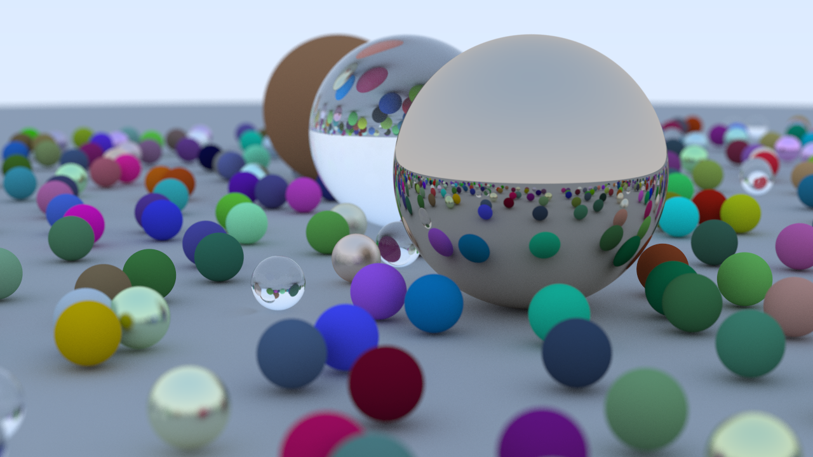

# Ray Tracing In One Weekend

Archived branch of learning to write a ray tracer.

Code in this branch was written by following the book [_Ray Tracing In One Weekend_](https://raytracing.github.io/books/RayTracingInOneWeekend.html).

### Usage
The code can be built using `cmake`.

Some launch arguments exist:

```bash
# shorthand
./rtweekend -w 1280 -s 500 -b 50 -o image # name without extension

# or
./rtweekend --width 1280 --samples-per-pixel 500 --max-ray-bounces 50 --output image
```

On Linux/Unix, image will write into a `ppm` file, and is later converted to `png` assuming that `ImageMagick` is installed. Otherwise, it only writes to a `ppm` file.

Refer `./convertPpmToPng.sh`.

Image found in `./output`. Refer `CMakeLists.txt`.


### Credits

- [_Ray Tracing in One Weekend_](https://raytracing.github.io/books/RayTracingInOneWeekend.html)

- Few articles explaining the math for parts of the rendering; however the math from those articles was not used. All math is from the book.